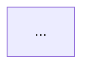
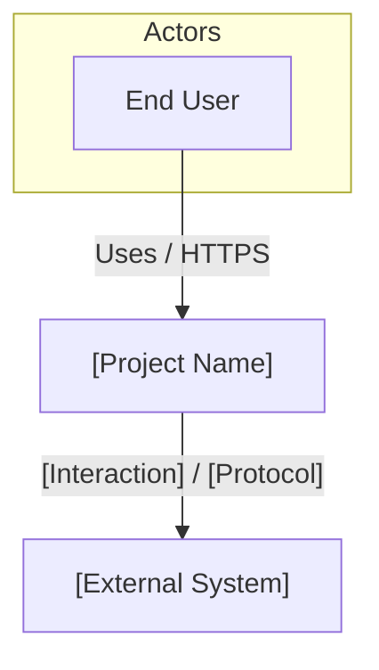

# c4-model Skill

Use before starting any feature that crosses system or container boundaries — or when onboarding a new developer who needs to understand the architecture. C4 diagrams are the entry point for understanding any UBITS project.

## Priority

This skill is **high priority**: run it at project setup and update it whenever a significant architectural change is made (new container, new external dependency, new integration).

## Instructions

Generate C4 diagrams for: $ARGUMENTS.

Accepted inputs:

- `context` — generate or update Level 1 (System Context)
- `container` — generate or update Level 2 (Container)
- `component [container-name]` — generate or update Level 3 (Component) for a specific container
- `all` — generate all three levels
- _(empty)_ — determine what's missing by reading `docs/architecture/` and generate what doesn't exist

### Step 1 — Read Existing Architecture

Before generating, read:

- `docs/base-standards.md` §2.4 for canonical stack defaults (NestJS, `@flux-ui/core`, Cypress)
- `docs/architecture/` for any existing diagrams
- `docs/backend-standards.md`, `docs/frontend-standards.md`, `docs/serverless-standards.md` for stack context
- `docs/data-model.md` for entity context
- `docs/api-spec.yml` for integration points

### Step 2 — Generate the Diagram(s)

**C4 is the modeling method; Mermaid `flowchart` is the rendering syntax.**

Do **not** use Mermaid's experimental C4 dialect (`C4Context`, `C4Container`, `C4Component`, `Person()`, `System()`, `Container()`, `Rel()`, `UpdateLayoutConfig`, etc.). Those diagrams fail to render in common Markdown previewers (Cursor, VS Code, Bitbucket in many setups) with **Mermaid Syntax Error**.

Always emit diagrams as:

````markdown

````

#### Mermaid flowchart conventions (mandatory)

| C4 concept                     | Mermaid flowchart pattern                |
| ------------------------------ | ---------------------------------------- |
| System / container boundary    | `subgraph id["Label"]` … `end`           |
| Person / actor                 | `id["Name<br/>Description"]`             |
| System / container / component | `id["Name<br/>Tech<br/>Responsibility"]` |
| Database                       | `id[("Name<br/>Tech<br/>Role")]`         |
| Queue                          | `id[["Name<br/>Tech<br/>Role"]]`         |
| Relationship                   | `from -->                                | "Label / protocol" | to` |

Additional rendering rules:

1. Start every diagram with `flowchart TB` (or `flowchart LR` only when a left-to-right layout is clearly clearer).
2. Prefer `<br/>` inside node labels for multi-line text; keep labels short.
3. Avoid characters that break Mermaid edge/node text: do not use bare `&` (write `and`), prefer ASCII over Unicode arrows (`→` → `to`), and avoid unquoted special punctuation in edge labels.
4. Use stable alphanumeric node IDs (`frontend`, `api`, `db`); never reuse the same ID twice in one diagram.
5. Keep the C4 _content_ accurate (actors, containers, protocols); only the _DSL_ is flowchart.
6. Match the style of existing files under `docs/architecture/c4-*.md` when updating.

#### Level contents

**Level 1 — System Context** (`docs/architecture/c4-context.md`)

- Show the system, its primary user personas, and all external systems it interacts with
- External systems include: UBITS Auth, AWS services, Jira, `@flux-ui/core`, any third-party APIs

**Level 2 — Container** (`docs/architecture/c4-container.md`)

- Show each deployable unit: Frontend MFE, Backend API, Lambda functions, Database, SQS queues, and other infra as applicable
- Show the technology for each container (React 19, NestJS, PostgreSQL, Lambda, etc.)
- Show communication protocols between containers (REST/HTTPS, SQS, Prisma/SQL, EventBridge)

**Level 3 — Component** (`docs/architecture/c4-component.md` or `c4-component-[container].md`)

- Show the internal components of a specific container inside a `subgraph`
- For NestJS backend: controllers, services, repositories, guards, event emitters
- For React frontend: pages/features, service layer, `@flux-ui/core` integration
- For Lambda: handler, service module, CDK construct

#### Minimal example (Context shape)



### Step 3 — Write the Files

For each diagram level, write the Markdown file with:

1. Title and Status table (`Customized: Yes` when filled with project truth)
2. A `## Diagram (Mermaid)` section containing **only** `flowchart` Mermaid blocks
3. A short narrative / responsibility table
4. Key decisions when useful

Use existing files in `docs/architecture/` as the structural base. Replace placeholders with real project content. Never reintroduce `C4Context` / `C4Container` / `C4Component` blocks.

### Step 4 — Update the Architecture Index

If `docs/architecture/README.md` doesn't exist, create it with a table linking to each diagram and its last-updated date. Note that diagrams are C4 _models_ rendered as Mermaid **flowchart**.

### Output Format

For each diagram generated:

1. Show the Mermaid `flowchart` code in the response for immediate review
2. Confirm the file was written to `docs/architecture/`
3. Note any assumptions made about the architecture that should be verified

## Notes

- C4 diagrams are living documentation — they should be updated when the architecture changes, not just at project start.
- Level 3 (Component) diagrams are optional for simple containers but required for the Backend API and any Lambda with complex internal structure.
- `@flux-ui/core` appears at Level 1 (external system) and Level 2 (dependency of the Frontend container).
- Keep diagrams accurate over comprehensive — a wrong diagram is worse than no diagram.
- If an older diagram still uses Mermaid C4 dialect, rewrite it to `flowchart` when touching that file.
