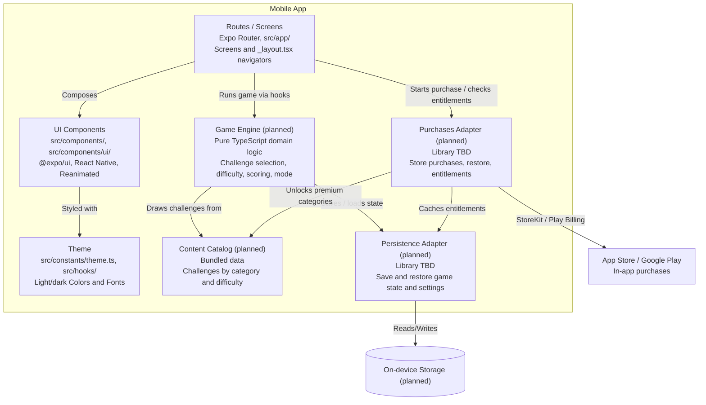

# C4 Level 3 — Component Diagram

> Customized for Prendidos. Create one file per container that needs component-level detail.

## Status

| Field      | Value                    |
| ---------- | ------------------------ |
| Customized | Yes                      |
| Container  | Mobile App (Expo SDK 58) |

## Container: Mobile App (Expo / React Native)

## Component Descriptions

| Component                           | Pattern                         | Responsibility                                                                                                                                     |
| ----------------------------------- | ------------------------------- | -------------------------------------------------------------------------------------------------------------------------------------------------- |
| **Routes / Screens**                | Expo Router file-based routes   | Thin screens in `src/app/` (age gate, home, category and mode selection, gameplay, results, store); `_layout.tsx` navigators; typed routes         |
| **UI Components**                   | Presentational components       | Reusable kebab-case components (`src/components/`, primitives in `src/components/ui/`) built on `@expo/ui`, React Native, `expo-image`, Reanimated |
| **Theme**                           | Design tokens + hooks           | Light/dark `Colors` and `Fonts` in `src/constants/theme.ts`, consumed via `use-theme` / `use-color-scheme`                                         |
| **Game Engine** _(planned)_         | Pure domain logic               | Challenge selection without repeats, difficulty filtering, turn order, scoring, friends vs. couple mode; no React or Expo imports                  |
| **Content Catalog** _(planned)_     | Bundled static data             | Typed challenges ("retos") grouped by category and difficulty; free vs. premium flags                                                              |
| **Persistence Adapter** _(planned)_ | Adapter (port + implementation) | Single entry point to on-device storage for game state, progress, settings, and cached entitlements; library TBD                                   |
| **Purchases Adapter** _(planned)_   | Adapter (port + implementation) | Wraps store-managed in-app purchases (App Store / Google Play): purchase, restore, entitlement checks; no card data; library TBD                   |

See `docs/base-standards.md` §2.3–§2.4 and `docs/frontend-standards.md`.

## Key Decisions

- Game logic is pure TypeScript so it can be unit-tested with Jest without rendering UI.
- Storage and purchase libraries sit behind adapters so the library choice (ADRs pending) does not leak into screens.
- The 18+ age gate is a route that runs before any content is shown.

---

_Duplicate this structure per container. Run `/c4-model` to regenerate. Render as Mermaid `flowchart` only — never Mermaid C4 dialect._
