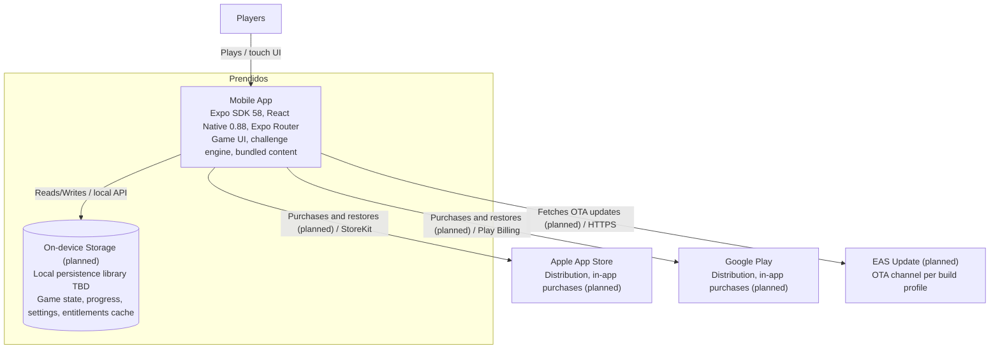

# C4 Level 2 — Container Diagram

> Customized for Prendidos. Update with `/c4-model` when containers are added or responsibilities change.

## Status

| Field      | Value |
| ---------- | ----- |
| Customized | Yes   |

## Diagram (Mermaid)

## Container Descriptions

| Container                         | Tech                                                                                          | Responsibility                                                                                                |
| --------------------------------- | --------------------------------------------------------------------------------------------- | ------------------------------------------------------------------------------------------------------------- |
| **Mobile App**                    | Expo SDK 58, React Native 0.88, React 19.3, TypeScript, Expo Router, `@expo/ui`, Reanimated 4 | Single native app for iOS and Android: age gate, category and mode selection, gameplay, scoring, purchases UI |
| **On-device Storage** _(planned)_ | Local persistence library — to be decided (ADR pending)                                       | Persist game state, progress, settings, and a cached copy of purchase entitlements                            |

**No backend API or remote database.** All content and state are on-device. External systems (not containers): Apple App Store and Google Play (distribution and store-managed in-app purchases) and EAS Update (OTA delivery of JS and assets on a channel mapped to each build profile).

Web output via `react-native-web` exists but is not a product target. See `docs/base-standards.md` §2.3–§2.4.

## Key Decisions

- One container: the Expo app. Adding a backend (for example, remote content or accounts) requires an ADR and an update to this diagram.
- Challenge content ships inside the app bundle; content changes reach players via EAS Update or a new store build.
- Store-managed purchases only; the app never handles card data.

---

_Update when containers are added or responsibilities change. Run `/c4-model` to regenerate. Render as Mermaid `flowchart` only — never Mermaid C4 dialect._
