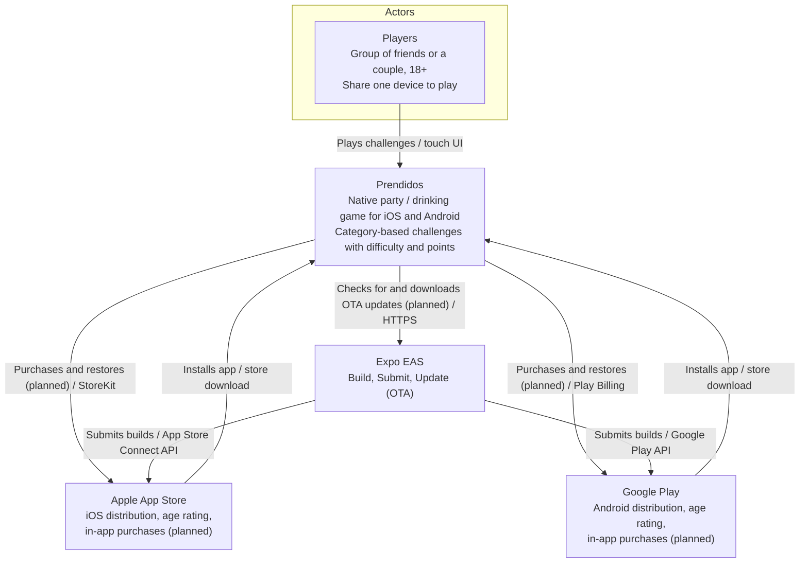

# C4 Level 1 — System Context Diagram

> Customized for Prendidos. Update with `/c4-model` when external relationships change.

## Status

| Field      | Value |
| ---------- | ----- |
| Customized | Yes   |

## Diagram (Mermaid)

## Narrative

| Element             | Description                                                                                                                                                                                                             |
| ------------------- | ----------------------------------------------------------------------------------------------------------------------------------------------------------------------------------------------------------------------- |
| **Players**         | Adults (18+) playing in a group of friends or as a couple. They pick a category, choose a difficulty, and complete challenges ("retos") to earn points, usually passing one device around.                              |
| **Prendidos**       | Expo / React Native app for iOS and Android. Challenge content and game state live on-device; there is no backend. Contains alcohol references, so it enforces an 18+ age gate and carries a matching store age rating. |
| **Apple App Store** | Distributes the iOS app, applies the age rating, and processes in-app purchases (planned). Purchases are store-managed — the app never handles card data.                                                               |
| **Google Play**     | Distributes the Android app, applies the content rating, and processes in-app purchases (planned) through Play Billing.                                                                                                 |
| **Expo EAS**        | Builds and signs the native binaries in the cloud, submits them to both stores, and serves over-the-air JS/asset updates (EAS Update, planned).                                                                         |

Stack: Expo SDK 58, React Native 0.88, Expo Router, EAS — see `docs/base-standards.md` §2.3–§2.4 and `docs/frontend-standards.md`.

## Key Decisions

- No backend for now: challenge content is bundled with the app and game state is stored on-device.
- Monetization uses store-managed in-app purchases (App Store / Google Play); purchase library to be decided (ADR pending).
- 18+ age gate in the app plus a matching store age rating because of alcohol references.

---

_Update when external relationships change. Run `/c4-model` to regenerate. Render as Mermaid `flowchart` only — never Mermaid C4 dialect._
