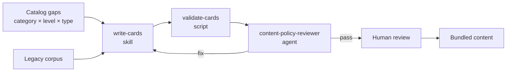

# Card Content

How Prendidos card copy is sourced, written, and reviewed. Product rules come from [`../prd.md`](../prd.md) §5.8, §6.2, and §6.3; entity shapes come from [`../data-model.md`](../data-model.md). The card face layout and the proposed data model change are in [`card-templates.md`](./card-templates.md).

## Legacy Corpus (2023)

The challenges from the previous Flutter app, kept as the **style reference** for new content.

| Path                            | Content                                                                    |
| ------------------------------- | -------------------------------------------------------------------------- |
| `legacy/legacy-challenges.json` | 108 challenges from `Lista de retos sin URL.xlsx`, normalized              |
| `legacy/cards/<legacyId>.png`   | The 31 designed cards (412 × 412) that existed for them, text baked in     |

**Status: reference only.** The corpus is never bundled in the app and never imported by code. It was written before the App Store and responsible-drinking rules (PRD §5.8, §8), and most cards break at least one of them. New playable cards are rewrites or new cards that pass the [review checklist](#review-checklist).

### Fields

| Field          | Meaning                                                                                              |
| -------------- | ---------------------------------------------------------------------------------------------------- |
| `legacyId`     | Original 8-hex ID (also the PNG file name). `start` is the opening card                              |
| `text`         | Spreadsheet copy, **verbatim** (typos and censoring asterisks kept)                                  |
| `legacyScore`  | Original 1–100 scale: 1–40 Suave, 41–75 Medio, 76–100 Hardcore. Not the PRD points scale (1–30)      |
| `drinks`       | Penalty drinks, 1–3. `0` means the card had no penalty                                               |
| `legacyLevel`  | Original level label (`Suave`, `Medio`, `Hardcore`)                                                  |
| `difficulty`   | Mapped PRD level: Suave → `easy`, Medio → `medium`, Hardcore → `hard`                                 |
| `legacyColor`  | Card background color from the sheet (the legacy palette, not the current tokens)                    |
| `slangTerms`   | Colombian slang the card uses, from the sheet's `Glosario` column                                    |
| `face`         | Only for the 31 designed cards: `headline`, `body`, `illustration`, `speechBubbles` transcribed from the PNG |
| `dataIssues`   | Problems found while importing (see below)                                                           |

### Known data issues

| Issue           | Cards                                  | Detail                                                       |
| --------------- | -------------------------------------- | ------------------------------------------------------------ |
| `missingText`   | `DA5D7170`                             | The text cell contained the ID; the copy is lost             |
| `missingScore`  | `2F9F2389`                             | "Ronda entera del juego de la botella" has no score          |
| `missingDrinks` | `2F9F2389`, `5673382A`                 | Empty drinks cell                                            |
| `invalidDrinks` | `95FB64BE`, `4DFCA632`, `F6143C8B`      | Cell held `44593`, a spreadsheet date serial; stored as `null` |

Other notes: the sheet's summary counts (64 / 31 / 18) are stale — the real split is 49 `easy`, 37 `medium`, 22 `hard`. `150F2E47` is labeled Hardcore but its PNG uses the Medio color. `86ECADCC` has duplicated text at the end. `B98FB490.png` and `Start(1).png` in the source folder were byte-identical copies of `start.png` and `150F2E47.png` and were not imported.

The spreadsheet's third sheet (`Lista de preguntas & Stuff`) also has truth questions (normal and spicy), "¿Presionarías el botón?" dilemmas, riddles, and trivia. They are **not imported yet**.

## Voice

What made the legacy cards work, and what new cards should keep.

- **Hook + instruction.** Every designed card splits into a short headline that carries the joke ("¡Abra la jeta!", "Momento sad de la noche", "Cultura time") and a plain instruction underneath. The slang lives in the hook; the instruction stays clear enough to play at 2 a.m.
- **Vocatives.** Cards talk to the player like a friend: *mi socio, pana, parce, cucho, mka, mi perro*. Several are male-coded (*mi perro, mi socio*) or female-coded (*la más…*), so new cards need neutral options for players with `undisclosed` gender (PRD §5.6).
- **Recurring formats.** Headlines repeat as series: "Cultura time" (cultura chopística), "Llegó el / la…", "It's time to…", "Se puso chimba esto". Formats make content cheap to extend and recognizable in play.
- **Spanglish and local references.** "Momento sad", "Historytime", "Time to make up", TikTok, notas de voz, mejores amigos de Instagram.
- **Mechanics mix.** Performance (sing, dance, imitate an accent), confession (chisme), group games (cultura chopística, teléfono roto), persistent rules ("durante una ronda…"), phone dares, and physical contact.

## Why Legacy Cards Fail Today

The rules a rewrite must fix, in order of how often they appear:

| Problem                         | Legacy examples                                                          | Rule                                    |
| ------------------------------- | ------------------------------------------------------------------------ | --------------------------------------- |
| Insulting penalty quips         | "por puss\*", "por loca", "por puto", "masculinidad frágil", "pelotudo"  | PRD §6.3 (no humiliation or discrimination) |
| Nudity and explicit sex         | porn photo, simulating sex, bra removal, showing the butt, moaning, positions | PRD §6.3, App Store 1.1.4           |
| Consent                         | kissing someone "if she doesn't want, you both drink", grabbing someone  | PRD §6.3; contact needs both players' yes |
| Unbounded drinking              | "por cada reacción tomas un trago durante todo el resto del juego" (`4A546080`) | PRD §5.8 (max 3 drinks), App Store 1.4.3 |
| Penalty mixed into the copy     | "si se niega se toma 2…" inside the text                                 | Breaks the "No toma" alternative penalty |
| People outside the game         | texting an ex, posting for 10 minutes, calling someone, handing over an unlocked phone | Privacy and harassment risk; rewrite with care |
| Gender-targeted wording         | "los hombres…", "a una mujer…", "del otro sexo"                          | Use `targetGender` and gender variants   |

### The copy game

Compliance must not make cards boring. The edge moves from explicit to **innuendo and social risk**, and penalty quips move from insults to **playful teasing**:

| Legacy                                                       | Direction for the rewrite                                                     |
| ------------------------------------------------------------ | ----------------------------------------------------------------------------- |
| "Uy pana muéstrese una foto porn\*"                          | "Uy pana, muestre la última foto de su galería. Sin trampa."                  |
| "Cultura chopística de posiciones sexuales"                  | Keep the "Cultura time" hook, swap the topic: excusas para no ir a trabajar, apodos de ex |
| "Llegó la más perra… le dice que sí a todo"                  | "Llegó la diva / el divo: durante una ronda dígale que sí a todo (dentro de lo legal)" |
| "…se toma 2 por puss\*"                                      | "Toma 2 tragos — por tibio / tibia" (or *aguado/a*, *casero/a*)               |

These are directions, not approved copy. Every new card still goes through human review (PRD §6.2).

## Planned Generation Pipeline

Not built yet. This is the proposed design; each piece lands as its own change.

| Piece                         | Kind                                          | Job                                                                                         |
| ----------------------------- | --------------------------------------------- | ------------------------------------------------------------------------------------------- |
| `write-cards` (built)         | Skill in `ai-specs/skills/write-cards/`      | Writes new cards or rewrites legacy ones for a category, level, type, and heat tier. References: `policy.md` (hard rules, heat tiers, consent, drinking) and `voice.md` (hooks, slang, gender). Gold examples come after human review |
| `validate-cards`              | Deterministic script + Jest test              | Schema, `drinks` 1–3, points within the level range, no "fondo blanco", unique and never-reused IDs, banned-word list, headline and body length limits |
| `content-policy-reviewer`     | Agent in `ai-specs/agents/`                   | Adversarial pass per card: verdict `pass` / `fix` / `reject` against the checklist below, plus a 1–5 fun score so compliant-but-boring cards also go back |
| Golden set                    | Eval in `ai-specs/evals/`                     | Legacy cards with expected verdicts, so changes to the skill or reviewer don't regress      |

The first job for the pipeline is rewriting the 108 legacy cards: it produces the gold examples and shows how many of them can be saved.

## Review Checklist

A card is shippable when all of these hold:

- [ ] At most 3 drinks, no "fondo blanco", no drinking that grows with time or reactions
- [ ] Penalty is separate from the copy, so non-drinkers get the alternative penalty
- [ ] No nudity, explicit sex, illegal drugs, or dangerous activity
- [ ] Any physical contact needs both players' agreement; if the other person declines, nobody is penalized
- [ ] No insult, humiliation, or stereotype based on gender, orientation, origin, or appearance
- [ ] Works for every gender: variants or neutral wording; `targetGender` set when the card depends on it
- [ ] Involves only people in the room, or the player chooses what to share outside it
- [ ] Sounds like a Colombian friend, not a translation — and is still fun
