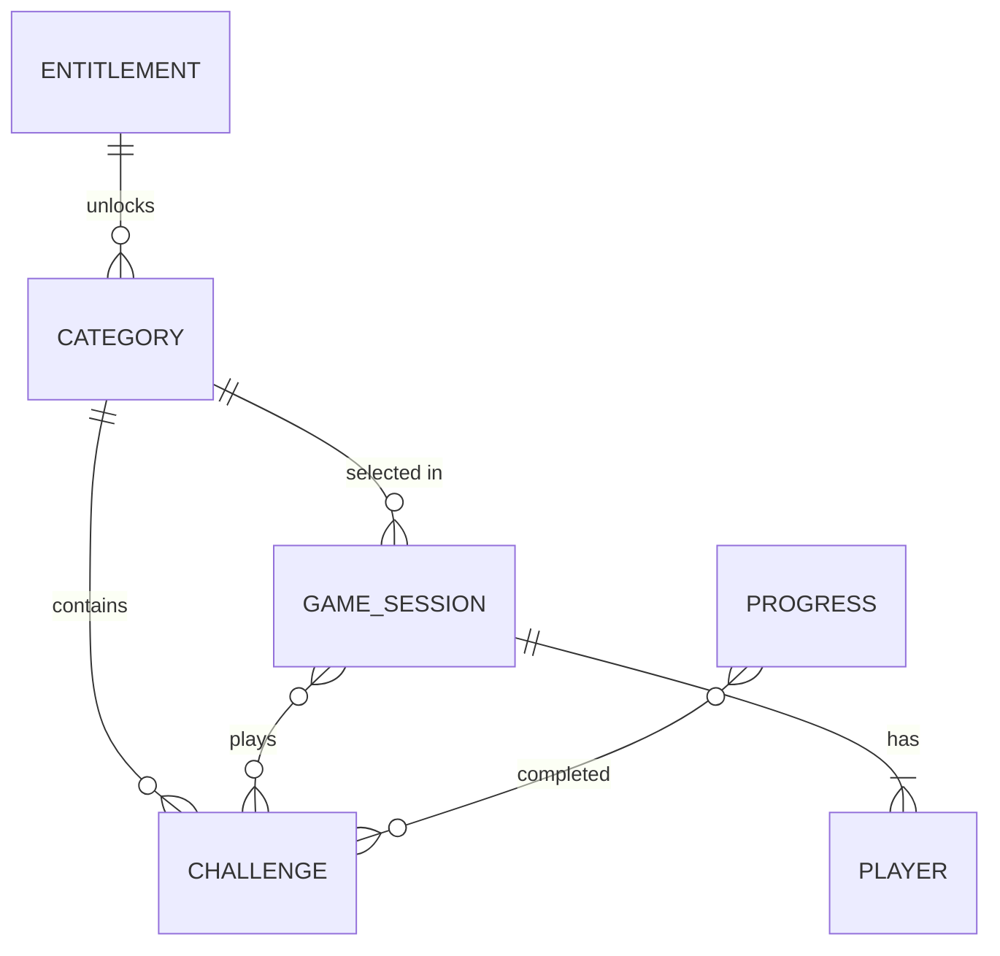

# Data Model

## Status

| Field              | Value                                                               |
| ------------------ | ------------------------------------------------------------------- |
| Customized         | Yes (domain only — storage not decided)                             |
| Database engine    | None server-side. On-device storage, library to be decided via ADR  |
| ORM / access layer | Repository adapters in `src/features/<feature>/` over local storage |

---

## Domain Overview

- Primary bounded contexts:
  - **Content** — categories and challenges bundled with the app (read-only at runtime; updated through app releases or EAS Update).
  - **Game** — a play session: mode, players, chosen category, challenge sequence, and scoring.
  - **Progress** — points and completed challenges persisted on the device.
  - **Purchases** — premium content unlocked through App Store / Google Play in-app purchases.
- Ubiquitous language (code in English, product copy in Spanish):

| Term (code)   | Product term (ES)  | Meaning                                              |
| ------------- | ------------------ | ---------------------------------------------------- |
| `Challenge`   | Reto               | A task players perform; may involve drinking         |
| `Category`    | Categoría          | Themed group of challenges chosen before playing     |
| `Difficulty`  | Nivel / dificultad | Challenge intensity level; drives points             |
| `GameMode`    | Modo               | `friends` (group) or `couple`                        |
| `GameSession` | Partida            | One play-through from category selection to summary  |
| `Player`      | Jugador            | A participant in a session (local only, no accounts) |
| `Points`      | Puntos             | Score earned by completing challenges                |

The entities below are the **initial domain model** derived from the product description. Refine them through OpenSpec changes as features are specified.

---

## Entities

### Category

**Description:** Themed set of challenges (bundled content).

| Field         | Type       | Required | Description                               |
| ------------- | ---------- | -------- | ----------------------------------------- |
| `id`          | string     | Yes      | Stable slug, e.g. `warm-up`               |
| `name`        | string     | Yes      | Display name (Spanish copy)               |
| `description` | string     | No       | Short description shown in the picker     |
| `modes`       | GameMode[] | Yes      | Modes the category supports               |
| `isPremium`   | boolean    | Yes      | Requires a purchase entitlement           |
| `productId`   | string     | No       | Store product ID when `isPremium` is true |

**Relationships:** has many `Challenge`.

### Challenge

**Description:** A single challenge card.

| Field         | Type       | Required | Description                                               |
| ------------- | ---------- | -------- | --------------------------------------------------------- |
| `id`          | string     | Yes      | Stable ID, unique across categories                       |
| `categoryId`  | string     | Yes      | Owning `Category.id`                                      |
| `text`        | string     | Yes      | Challenge copy (Spanish); may contain player placeholders |
| `difficulty`  | Difficulty | Yes      | `easy` \| `medium` \| `hard` (levels to be confirmed)     |
| `points`      | number     | Yes      | Points awarded on completion                              |
| `alternative` | string     | No       | Non-alcoholic alternative for drinking challenges         |
| `modes`       | GameMode[] | Yes      | Modes where the challenge can appear                      |

**Validation rules:** `points` > 0; `categoryId` must reference an existing category; IDs never reused once shipped (progress depends on them).

### GameSession

**Description:** In-memory state of a play-through; persisted only to resume an interrupted game.

| Field                | Type                     | Required | Description                       |
| -------------------- | ------------------------ | -------- | --------------------------------- |
| `id`                 | string                   | Yes      | Generated locally                 |
| `mode`               | GameMode                 | Yes      | `friends` or `couple`             |
| `categoryId`         | string                   | Yes      | Selected category                 |
| `players`            | Player[]                 | Yes      | Local players (name only)         |
| `playedChallengeIds` | string[]                 | Yes      | Prevents repeats within a session |
| `scores`             | Record<playerId, number> | Yes      | Points per player                 |
| `startedAt`          | ISO date                 | Yes      |                                   |

### Progress

**Description:** Per-device record of completed challenges and accumulated points.

| Field                   | Type     | Required | Description                    |
| ----------------------- | -------- | -------- | ------------------------------ |
| `completedChallengeIds` | string[] | Yes      |                                |
| `totalPoints`           | number   | Yes      |                                |
| `ageConfirmedAt`        | ISO date | No       | When the 18+ gate was accepted |

### Entitlement

**Description:** Cached result of store purchases; the store SDK is the source of truth.

| Field        | Type     | Required | Description                        |
| ------------ | -------- | -------- | ---------------------------------- |
| `productId`  | string   | Yes      | Store product ID                   |
| `active`     | boolean  | Yes      | Last verified state                |
| `verifiedAt` | ISO date | Yes      | Last successful store verification |

---

## Entity-Relationship Diagram

---

## Schema Conventions

- Primary key strategy: stable string slugs for bundled content; locally generated IDs for sessions.
- Timestamps: ISO 8601 strings in UTC.
- Soft delete: not applicable (no server-side user data). Content removal must keep old IDs reserved.
- Naming: camelCase fields in TypeScript types; storage keys namespaced per feature (e.g. `progress.v1`), with a version suffix for migrations.

---

## Migration Notes

- All schema changes go through **versioned migrations** of the project ORM (none today; applies if a database or backend is added) — never ad-hoc SQL execution by agents
- Prefer backwards-compatible expand/contract changes; run `migration-review` before merge
- Agents must not execute `db:seed`, `db:wipe`, `migrate reset`, or equivalent — when seeding/wiping is required for verification, hand the **exact command** to the human (HITL), wait for confirmation, then continue (see `docs/security-standards.md` § Agent operational constraints)
- Soft delete: document fields/strategy here when the project uses soft delete

- On-device storage: when a persisted shape changes, bump the storage key version and write a migration function from the previous version — never silently drop user progress.
