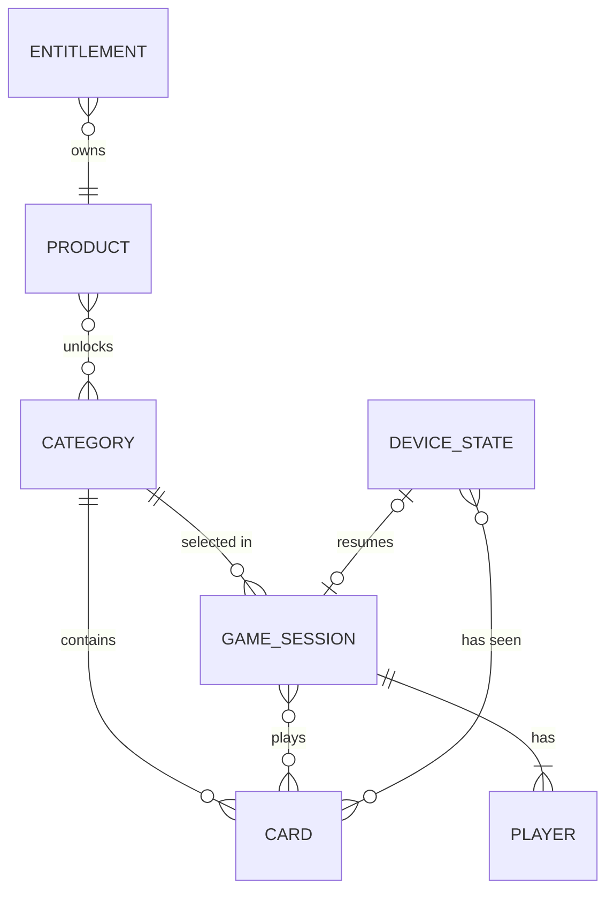

# Data Model

## Status

| Field              | Value                                                               |
| ------------------ | ------------------------------------------------------------------- |
| Customized         | Yes                                                                 |
| Database engine    | None server-side. On-device `expo-sqlite/kv-store`, key `device.v1` ([ADR-0001](./adr/0001-on-device-storage-expo-sqlite-kv-store.md)) |
| ORM / access layer | Repository adapters in `src/features/<feature>/` over local storage |
| Product source     | [`docs/prd.md`](./prd.md) (Spanish) — this model must stay aligned  |

---

## Domain Overview

- Primary bounded contexts:
  - **Content** — categories, cards, and generic alternative penalties bundled with the app (read-only at runtime; updated through app releases or EAS Update).
  - **Game** — a play session: settings, players, card sequence, scoring, and end condition.
  - **Device state** — age confirmation, last players, seen-card history, and the resumable session, persisted on the device. No historical statistics.
  - **Purchases** — content unlocked through App Store / Google Play non-consumable in-app purchases.
- Ubiquitous language (code in English, product copy in Spanish):

| Term (code)           | Product term (ES)              | Meaning                                                                 |
| --------------------- | ------------------------------ | ----------------------------------------------------------------------- |
| `GameMode`            | Modo                           | `friends` (Amigos) or `couple` (Pareja)                                 |
| `Category`            | Categoría                      | Themed content set; belongs to exactly one mode; one per session        |
| `Difficulty`          | Nivel                          | `easy` (Suave), `medium` (Picante), `hard` (Prendido)                   |
| `Card`                | Carta                          | A unit of content shown on screen                                       |
| `CardType`            | Tipo de carta                  | `challenge` (Reto), `truth` (Verdad), `everyoneWho` (Todos los que…), `neverHaveIEver` (Yo nunca) |
| Individual card       | Reto / Verdad                  | `challenge` or `truth`: targets the current player, has points, consumes the turn |
| Group card            | Carta grupal                   | `everyoneWho` or `neverHaveIEver`: interlude, no points, does not consume a turn |
| `Penalty`             | Castigo                        | What a player does when refusing a card                                 |
| `Heat`                | Sin Filtro                     | `standard` or `spicy`; `spicy` cards are the opt-in Sin Filtro layer (friends mode only) |
| `AlternativePenalty`  | Castigo alternativo            | Generic non-alcoholic penalty per difficulty, for players who don't drink |
| `Player`              | Jugador                        | A local participant (no accounts)                                       |
| `GameSession`         | Partida                        | One play-through from setup to final ranking                            |
| Round                 | Ronda                          | One turn per player                                                     |
| `Product`             | Pack / Pase total              | A store product that unlocks content                                    |
| `Entitlement`         | Compra                         | Cached ownership of a product                                           |

---

## Entities

### Category

**Description:** Themed set of cards (bundled content).

| Field             | Type         | Required | Description                                                                  |
| ----------------- | ------------ | -------- | ---------------------------------------------------------------------------- |
| `id`              | string       | Yes      | Stable slug, e.g. `la-previa`                                                |
| `name`            | string       | Yes      | Display name (Spanish copy)                                                  |
| `description`     | string       | No       | Short description shown in the picker                                        |
| `mode`            | GameMode     | Yes      | The single mode this category belongs to                                     |
| `freeDifficulties` | Difficulty[] | Yes     | Difficulties playable without a purchase (`[]` = fully paid, all three = fully free) |

**Relationships:** has many `Card`; unlocked by one or more `Product`.

**Launch catalog (provisional names, see PRD §6.1):**

| `id`         | `mode`    | `freeDifficulties`       |
| ------------ | --------- | ------------------------ |
| `la-previa`  | `friends` | `easy`, `medium`, `hard` |
| `entre-dos`  | `couple`  | `easy`                   |

Sin Filtro is not a category: it is the `spicy` heat layer inside `friends` categories (PRD §6.4).

### Card

**Description:** A single piece of content. Replaces the former `Challenge` entity; `challenge` is now one `CardType`. Implemented in `src/features/content/card-types.ts`; layouts in [`content/card-templates.md`](./content/card-templates.md).

| Field             | Type             | Required             | Description                                                                                   |
| ----------------- | ---------------- | -------------------- | --------------------------------------------------------------------------------------------- |
| `id`              | string           | Yes                  | Stable ID, unique across categories                                                           |
| `categoryId`      | string           | Yes                  | Owning `Category.id` (mode is derived from the category)                                      |
| `type`            | CardType         | Yes                  | `challenge` \| `truth` \| `everyoneWho` \| `neverHaveIEver`                                   |
| `difficulty`      | Difficulty       | Yes                  | `easy` \| `medium` \| `hard`                                                                  |
| `headline`        | GenderedText     | Individual cards     | The hook ("¡Abra la jeta!"); optional for group cards, which show their type label           |
| `body`            | GenderedText     | Yes                  | The instruction only — never the penalty                                                      |
| `points`          | number           | Individual cards     | Points awarded on completion; must fall within the difficulty range. Absent for group cards   |
| `penalty`         | DrinkPenalty     | Individual cards     | `{ drinks: 1 \| 2 \| 3; quip?: GenderedText }`, rendered by the app ("Toma 2 tragos — por aguafiestas"). Absent for group cards |
| `heat`            | Heat             | Yes                  | `standard` \| `spicy`; `spicy` only in `friends` categories                                   |
| `requiresConsent` | boolean          | Yes                  | The card involves touch; the app shows "Solo si la otra persona acepta"                      |
| `reachesOutside`  | boolean          | Yes                  | Calls, messages, or posts; the app shows the outside-contact rules                           |
| `illustration`    | string           | No                   | Key into the bundled illustration library                                                     |
| `targetGender`    | `male` \| `female` | No                 | When set, the card targets (or mentions) a player of that gender; skipped if none is eligible |
| `sourceLegacyId`  | string           | No                   | Legacy card this one rewrites (`docs/content/legacy/legacy-challenges.json`)                 |

**`GenderedText`:** a plain string. `{player}` (and `{partner}` in `couple` categories) are placeholders; `{masculine|feminine|neutral}` is a gender variant with exactly three non-blank options, e.g. `{el divo|la diva|la estrella}`.

- The copy speaks to the **current player** (usted); gender variants agree with the current player's `gender`, and `undisclosed` gets the neutral option.
- `{player}` is **another** player the app picks for the card (PRD §5.6 `{jugador}`); `{partner}` is the other player in couple mode.
- Copy never needs agreement with `{player}`'s gender: write that part neutrally ("la persona de su derecha", "{player}").
- Group cards (`everyoneWho`, `neverHaveIEver`) speak to the whole group: their variants always render the neutral option, and they cannot use placeholders.

**Validation rules:** enforced by `validateCards` in `src/features/content/validate-cards.ts` and specified in the `card-content` OpenSpec capability. A catalog can ship when it has no **errors** (`hasErrors`) and a human has reviewed every **warning**.

- Errors: well-formed categories (unique slug-like ID, `mode` `friends` | `couple`, valid `freeDifficulties`); unique card IDs that are slugs; existing category; only known fields (skill authoring notes allowed, `null` = unset); required fields per type and non-blank text; points range per difficulty (`easy` 1–10, `medium` 11–20, `hard` 21–30); `penalty.drinks` 1–3 (App Store guideline 1.4.3) with only `drinks` and a non-blank `quip`; no points or penalty on group cards; headline ≤ 45, body ≤ 240, quip ≤ 30 characters in the longest variant; `spicy` only in `friends`; well-formed placeholders and variants, with no placeholders in group cards; `targetGender` never `undisclosed`.
- Warnings (text heuristics for human review): banned phrases ("fondo blanco", legacy slurs in masculine and feminine forms), and amounts to drink in the body or quip ("se toma 2", "tres guaros").

- IDs are never reused once shipped (seen-card history depends on them).
- Launch target: 90 cards per block of 30 per difficulty (La Previa standard, La Previa spicy, Entre Dos), mixed ~60 % `challenge`, ~20 % `truth`, ~20 % group cards.

### AlternativePenalty

**Description:** Generic non-alcoholic penalty shown to players who don't drink, for individual and group cards.

| Field        | Type         | Required | Description                         |
| ------------ | ------------ | -------- | ----------------------------------- |
| `id`         | string       | Yes      | Stable ID                           |
| `difficulty` | Difficulty   | Yes      | Level the penalty matches           |
| `text`       | GenderedText | Yes      | Spanish copy, e.g. "Haz 10 sentadillas" |

### Player

**Description:** A local participant in a session.

| Field    | Type         | Required | Description                                          |
| -------- | ------------ | -------- | ---------------------------------------------------- |
| `id`     | string       | Yes      | Generated locally                                    |
| `name`   | string       | Yes      | Display name                                         |
| `gender` | PlayerGender | Yes      | `male` \| `female` \| `undisclosed` (Prefiero no decir) |
| `drinks` | boolean      | Yes      | `false` = gets alternative penalties instead of drinks |

**Privacy:** player names and genders never leave the device and are never sent to analytics.

### GameSettings

**Description:** Configuration chosen in the setup screen.

| Field                  | Type          | Required | Description                                                                 |
| ---------------------- | ------------- | -------- | --------------------------------------------------------------------------- |
| `mode`                 | GameMode      | Yes      | `friends` or `couple`                                                       |
| `categoryId`           | string        | Yes      | Must belong to `mode`                                                       |
| `players`              | Player[]      | Yes      | Turn order = array order (can be shuffled before starting)                  |
| `selectedDifficulties` | Difficulty[]  | Yes      | Defaults to all three; escalation walks only through the selected ones      |
| `endCondition`         | EndCondition  | Yes      | Defaults to `{ type: 'rounds', rounds: 10 }`                                |
| `spicyEnabled`         | boolean       | Yes      | Sin Filtro switch; `false` in `couple` mode or when the layer is locked; preloaded from `DeviceState.lastSpicyEnabled` |

**`EndCondition`** (discriminated union):

| `type`   | Extra field                    | Rule                                                                                 |
| -------- | ------------------------------ | ------------------------------------------------------------------------------------ |
| `rounds` | `rounds`: 5 \| 10 \| 15 \| 20  | Ends after the last round                                                            |
| `points` | `target`: 100 \| 200 \| 300    | When a player reaches `target`, the current round finishes, then the game ends       |
| `open`   | —                              | Ends when the group closes it                                                        |

**Validation rules:** `friends` requires 2–12 players; `couple` requires exactly 2; `selectedDifficulties` is non-empty.

### GameSession

**Description:** State of a play-through. Persisted so an interrupted game can be resumed.

| Field                 | Type                       | Required | Description                                                          |
| --------------------- | -------------------------- | -------- | -------------------------------------------------------------------- |
| `id`                  | string                     | Yes      | Generated locally                                                    |
| `settings`            | GameSettings               | Yes      | Snapshot of the setup                                                |
| `status`              | `inProgress` \| `finished` | Yes      |                                                                      |
| `currentRound`        | number                     | Yes      | 1-based                                                              |
| `currentPlayerIndex`  | number                     | Yes      | Index into `settings.players`                                        |
| `scores`              | Record<playerId, number>   | Yes      | Can be negative                                                      |
| `playedCardIds`       | string[]                   | Yes      | Prevents repeats within the session                                  |
| `swapsUsed`           | Record<playerId, boolean>  | Yes      | One free card swap per player per session                            |
| `couplePaywallShown`  | boolean                    | Yes      | The couple-mode soft paywall is shown at most once per session       |
| `startedAt`           | ISO date                   | Yes      |                                                                      |

**Game rules (domain logic, see PRD §5):**

- Completing an individual card adds `points`. Refusing subtracts `ceil(points / 2)` and shows the card's `penalty` (or an `AlternativePenalty` when `drinks` is `false`).
- Group cards are interludes: no points, no turn consumed.
- Escalation: by session progress (thirds for `rounds` / `points`; every N rounds for `open`), and by ascending `points` within a difficulty.
- Locked difficulties (no free access and no entitlement) are skipped; in couple mode the soft paywall appears once when escalation reaches a locked level, then play continues with the unlocked levels.
- Cards are not repeated within a session; unseen cards (per `DeviceState.seenCardIds`) are preferred; an exhausted difficulty pool resets.
- Ties share the rank.

### DeviceState

**Description:** Per-device persisted data outside a session. Replaces the former `Progress` entity — there are no cumulative points or historical statistics.

| Field            | Type     | Required | Description                                      |
| ---------------- | -------- | -------- | ------------------------------------------------ |
| `ageConfirmedAt` | ISO date | No       | When the "Soy mayor de 18" gate was accepted     |
| `lastPlayers`    | Player[] | Yes      | Preloads the next setup                          |
| `seenCardIds`    | string[] | Yes      | Cards shown in previous sessions                 |
| `lastSpicyEnabled` | boolean | Yes     | Last Sin Filtro switch value; `false` on first use |
| `activeSession`  | GameSession | No    | The resumable in-progress session, if any        |

### Product

**Description:** Bundled catalog of store products and what they unlock. Prices are set in App Store Connect / Google Play Console.

| Field       | Type                 | Required | Description                                                         |
| ----------- | -------------------- | -------- | ------------------------------------------------------------------- |
| `productId` | string               | Yes      | Store product ID (same on both stores when possible)                |
| `kind`      | `categoryPack` \| `difficultyPack` \| `spicyLayer` \| `allAccess` | Yes | What the product unlocks           |
| `unlocks`   | ContentUnlock[]      | `categoryPack`, `difficultyPack` | `{ categoryId, difficulties }` pairs        |

`spicyLayer` (Sin Filtro) unlocks the `spicy` cards of every current and future `friends` category the user can access. `allAccess` (Pase total) unlocks every current **and future** category, difficulty, and the Sin Filtro layer.

**Launch products (PRD §7):**

| `kind`           | Unlocks                                  | Price    |
| ---------------- | ---------------------------------------- | -------- |
| `spicyLayer`     | Sin Filtro in all `friends` categories   | USD 1.99 |
| `difficultyPack` | `entre-dos`: `medium`, `hard`            | USD 1.99 |
| `allAccess`      | Everything, including future content     | USD 2.99 |

`categoryPack` stays for future paid categories (PRD §7).

**Access rule:** a card is playable when its `difficulty` is in `Category.freeDifficulties`, or an active `Entitlement` unlocks that `(categoryId, difficulty)`, or an active `allAccess` entitlement exists. A `spicy` card also needs `GameSettings.spicyEnabled` and an active `spicyLayer` or `allAccess` entitlement.

### Entitlement

**Description:** Cached result of store purchases; the store SDK is the source of truth. Allows offline unlocks.

| Field        | Type     | Required | Description                        |
| ------------ | -------- | -------- | ---------------------------------- |
| `productId`  | string   | Yes      | References `Product.productId`     |
| `active`     | boolean  | Yes      | Last verified state                |
| `verifiedAt` | ISO date | Yes      | Last successful store verification |

---

## Entity-Relationship Diagram

---

## Schema Conventions

- Primary key strategy: stable string slugs for bundled content; locally generated IDs for sessions and players.
- Timestamps: ISO 8601 strings in UTC.
- Soft delete: not applicable (no server-side user data). Content removal must keep old IDs reserved.
- Naming: camelCase fields and enum values in TypeScript types; storage keys namespaced per feature (e.g. `device.v1`), with a version suffix for migrations.

---

## Migration Notes

- All schema changes go through **versioned migrations** of the project ORM (none today; applies if a database or backend is added) — never ad-hoc SQL execution by agents
- Prefer backwards-compatible expand/contract changes; run `migration-review` before merge
- Agents must not execute `db:seed`, `db:wipe`, `migrate reset`, or equivalent — when seeding/wiping is required for verification, hand the **exact command** to the human (HITL), wait for confirmation, then continue (see `docs/security-standards.md` § Agent operational constraints)
- Soft delete: document fields/strategy here when the project uses soft delete

- On-device storage: when a persisted shape changes, bump the storage key version and write a migration function from the previous version — never silently drop user progress.
