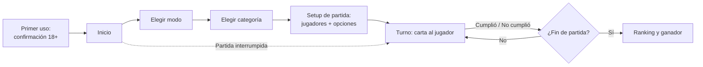

# Prendidos — PRD (MVP)

## Estado

| Campo              | Valor                                                    |
| ------------------ | -------------------------------------------------------- |
| Versión            | 1.1 (MVP) — Sin Filtro pasa de categoría a capa opcional |
| Fecha              | 2026-10-31                                               |
| Lanzamiento meta   | Publicado en App Store y Google Play antes del 2026-12-15 |
| Plataformas        | iOS y Android (web fuera de alcance)                     |
| Idioma del producto | Español colombiano                                      |

> Este documento es la fuente de verdad del **qué** y el **por qué** del producto. El **cómo** técnico vive en `docs/data-model.md`, `docs/frontend-standards.md` y en los cambios de OpenSpec, que deben ser coherentes con este PRD.

---

## 1. Visión y objetivo

**Prendidos** es un juego de fiesta para tomar, nativo para iPhone y Android. Un grupo de amigos (o una pareja) elige una categoría y va pasando el celular: a cada jugador le sale un reto o una verdad con un nivel de dificultad. Cumplir suma puntos; negarse resta puntos y trae un castigo. Al final hay un ranking y un ganador.

**Objetivo de negocio:** validar primero, monetizar después. El MVP debe ser pequeño, salir en temporada de fiestas de fin de año y medir si hay retención y conversión a pago suficientes para invertir en más contenido y en otros mercados.

---

## 2. Mercado y público

### 2.1 Mercado

- **Inicial:** solo Colombia.
- **Idioma y tono:** español con humor y jerga colombiana. Este tono local es parte del diferencial.
- LatAm y la neutralización del copy son posteriores al MVP.

### 2.2 Público

| Segmento    | Descripción                                                                                                 |
| ----------- | ----------------------------------------------------------------------------------------------------------- |
| **Primario**   | Grupos de 18 a 30 años en una previa, fiesta o reunión, de 3 a 8 personas, que se pasan un solo celular. |
| **Secundario** | Parejas adultas que buscan un plan coqueto y divertido entre dos.                                        |

Todos los usuarios son mayores de 18 años (ver §8).

### 2.3 Diferencial frente a la competencia

Frente a Picolo, "Toma o Reta" y las apps de "Yo nunca" / "Verdad o reto":

1. **Contenido local colombiano**: humor, modismos y situaciones reconocibles.
2. **Dificultad que escala**: la partida arranca suave y se va calentando sola.
3. **Competencia por puntos con ganador**: la mayoría de las apps similares no tienen ranking.

---

## 3. Métricas de éxito

Ventana de evaluación: **30 días después del lanzamiento**.

| KPI                                | Meta     |
| ---------------------------------- | -------- |
| Instalaciones                      | ≥ 1.000  |
| Retención D7                       | ≥ 15 %   |
| Conversión a pago (usuarios que compran algo) | ≥ 3 %  |
| Partidas por usuario activo        | ≥ 2      |

Si se cumplen, se invierte en más packs de contenido y en expansión a LatAm.

**Medición:** analítica anónima de eventos (p. ej. partida iniciada, partida terminada, paywall visto, compra iniciada/completada) **sin identificadores publicitarios** (sin IDFA, sin prompt de ATT en iOS). La herramienta se decide en un ADR. Las métricas de instalación y compra se cruzan con App Store Connect y Google Play Console.

---

## 4. Glosario

| Término (producto) | Término (código) | Significado                                                                           |
| ------------------ | ---------------- | ------------------------------------------------------------------------------------- |
| Modo               | `GameMode`       | `Amigos` (`friends`) o `Pareja` (`couple`)                                            |
| Categoría          | `Category`       | Tema de contenido. Pertenece a un solo modo. Se juega una por partida                 |
| Nivel              | `Difficulty`     | `Suave` (`easy`), `Picante` (`medium`), `Prendido` (`hard`)                           |
| Carta              | `Card`*          | Unidad de contenido que aparece en pantalla: reto, verdad o carta grupal               |
| Reto               | `Challenge`      | Carta individual: el jugador de turno debe hacer algo                                 |
| Verdad             | —                | Carta individual: el jugador de turno debe responder con la verdad                    |
| Carta grupal       | —                | "Todos los que…" o "Yo nunca": interludio que involucra a todo el grupo               |
| Castigo            | —                | Lo que hace el jugador al negarse a una carta (tomar, o la alternativa si no toma)    |
| Sin Filtro         | `heat: 'spicy'`  | Capa opcional de cartas más atrevidas (no explícitas) en modo Amigos. Apagada por defecto; se desbloquea con compra (ver §6.4) |
| Partida            | `GameSession`    | Una sesión de juego desde el setup hasta el ranking final                             |
| Ronda              | —                | Un turno de cada jugador                                                              |
| Pack               | —                | Producto de compra única que desbloquea contenido                                     |

\* Los nombres de código definitivos se fijan en `docs/data-model.md`.

---

## 5. Mecánica de juego

### 5.1 Flujo general

### 5.2 Modos

| Modo       | Jugadores     | Contenido                                                     |
| ---------- | ------------- | ------------------------------------------------------------- |
| **Amigos** | 2 a 12        | Retos, verdades y cartas grupales para un grupo               |
| **Pareja** | Exactamente 2 | Contenido coqueto y picante, **no explícito** (ver §6.3)     |

Ambos modos están en el MVP.

### 5.3 Setup de la partida

En una sola pantalla de configuración:

1. **Jugadores**: nombre y género de cada jugador.
   - Opciones de género: **Hombre / Mujer / Prefiero no decir**.
   - Marca **"No toma"** por jugador (ver §5.8).
   - Se precargan los jugadores de la última partida.
2. **Orden de turnos**: el orden en que se ingresaron los jugadores, con un botón para **barajar**.
3. **Niveles** (opcional): por defecto se usan los tres con escalada automática. Se puede restringir a **uno o varios niveles**; la escalada recorre solo los elegidos.
4. **Fin de partida** (ver §5.7): por defecto **10 rondas**.
5. **Retos Sin Filtro** (solo modo Amigos, ver §6.4): interruptor **apagado en el primer uso**; después el setup recuerda la última elección del dispositivo. Si no está desbloqueado, se ve con candado y abre el paywall.

### 5.4 Niveles y puntos

| Nivel        | Código   | Rango de puntos por carta |
| ------------ | -------- | ------------------------- |
| **Suave**    | `easy`   | 1–10                      |
| **Picante**  | `medium` | 11–20                     |
| **Prendido** | `hard`   | 21–30                     |

- Cada carta individual (reto o verdad) tiene **su propio puntaje** dentro del rango de su nivel. Más puntos significa una carta más difícil dentro de ese nivel.
- Las cartas grupales no tienen puntos.

### 5.5 Escalada de dificultad

- **Por defecto:** la partida empieza en Suave y va subiendo a Picante y Prendido según el **progreso de la partida**:
  - Partida por rondas o por meta de puntos: la partida se divide en tercios (Suave → Picante → Prendido).
  - Partida abierta: se sube de nivel cada N rondas (N a definir en diseño).
- **Dentro de un nivel**, las cartas salen de menor a mayor puntaje, así la intensidad también escala dentro del nivel.
- **Con niveles restringidos:** la escalada recorre solo los niveles elegidos (p. ej. Picante + Prendido: empieza en Picante y termina en Prendido). Con un solo nivel, la escalada es solo por puntaje dentro de ese nivel.

### 5.6 Tipos de carta

| Tipo                  | Proporción aprox. | A quién va                         | Puntos | Consume turno |
| --------------------- | ----------------- | ---------------------------------- | ------ | ------------- |
| **Reto**              | 60 %              | Jugador de turno                   | Sí     | Sí            |
| **Verdad**            | 20 %              | Jugador de turno                   | Sí     | Sí            |
| **Todos los que…**    | 20 % (con Yo nunca) | Todo el grupo                    | No     | No            |
| **Yo nunca**          |                   | Todo el grupo                      | No     | No            |

- La proporción es fija en el MVP (no configurable).
- Las cartas grupales aparecen como **interludios** entre turnos: todos los aludidos toman y después el turno sigue con el siguiente jugador que correspondía, sin afectar el ranking.
- Todas las cartas, incluidas las grupales, tienen nivel y siguen la escalada.

#### Menciones y género

- Las cartas pueden mencionar a otros jugadores con placeholders (p. ej. *"Dale un beso en la mejilla a {jugador}"*). La app elige al azar a otro jugador. En Pareja, `{pareja}` es el otro jugador.
- El género de cada jugador se usa para:
  - **Concordancia gramatical** (p. ej. *"el/la siguiente"*, *"tu compañero/compañera"*).
  - **Cartas dirigidas por género** (p. ej. *"alguien del género opuesto"*).
- Un jugador con **"Prefiero no decir"** recibe redacción neutra y nunca es elegido por una carta dirigida por género.
- Si una carta dirigida no tiene ningún jugador elegible, se salta y sale otra.

### 5.7 Turno y puntuación

En cada turno la carta muestra el nombre del jugador, el texto, el nivel, los puntos y el castigo. Quien tenga el celular marca lo que el grupo decida, de palabra:

| Acción               | Efecto                                                                                                 |
| -------------------- | ------------------------------------------------------------------------------------------------------ |
| **Cumplió**          | Suma los puntos de la carta.                                                                           |
| **No cumplió**       | Resta **la mitad** de los puntos de la carta, **redondeando hacia arriba** (7 pts → −4), y el jugador cumple el castigo de la carta. El puntaje **puede quedar negativo**. |
| **Cambiar carta**    | Sale otra carta sin penalización. **1 cambio por jugador por partida.**                                |

No hay votación dentro de la app.

#### Fin de partida

| Modo de fin        | Opciones (dropdown) | Regla                                                                                   |
| ------------------ | ------------------- | --------------------------------------------------------------------------------------- |
| **Por rondas** (defecto) | 5 / **10** / 15 / 20 — defecto 10 | Termina al completar las rondas.                       |
| **Meta de puntos** | 100 / 200 / 300     | Cuando alguien alcanza la meta, **se termina la ronda en curso** para que todos tengan los mismos turnos; gana el mayor puntaje. |
| **Abierta**        | —                   | Termina cuando el grupo decide cerrarla.                                                 |

En cualquier modo el grupo puede terminar la partida antes. Al final se muestra el **ranking**; en caso de empate, los empatados **comparten** el puesto.

### 5.8 Castigos y juego sin alcohol

- **Castigo con alcohol:** cada carta individual define su propio castigo (p. ej. *"Toma 2 tragos"*).
- **Límites obligatorios** (cumplimiento de App Store guideline 1.4.3 y consumo responsable):
  - Máximo **3 tragos** por castigo.
  - **Nunca "fondo blanco"** ni terminarse la bebida.
- **Jugadores que no toman:** reciben un **castigo alternativo** tomado de una **lista genérica por nivel** (p. ej. *"Haz 10 sentadillas"*). Aplica también a las cartas grupales.

### 5.9 Repetición de cartas

- Ninguna carta se repite dentro de la misma partida.
- Se priorizan las cartas **no vistas en partidas anteriores** (historial local).
- Si se agotan las cartas de un nivel, se reinicia el pool de ese nivel.

### 5.10 Persistencia en el dispositivo

| Se guarda                               | Para qué                               |
| --------------------------------------- | -------------------------------------- |
| Confirmación 18+                        | No volver a pedirla                    |
| Partida en curso                        | Retomarla ("Continuar partida") si la app se cierra |
| Últimos jugadores (nombre, género, no toma) | Precargar el setup                 |
| Historial de cartas vistas              | Priorizar cartas nuevas                |
| Compras (cache)                         | Desbloqueos sin conexión; la tienda es la fuente de verdad |

**No** se guardan estadísticas históricas (partidas jugadas, victorias, puntos acumulados).

Todo funciona **sin conexión**, excepto comprar y restaurar compras.

---

## 6. Contenido

### 6.1 Contenido del lanzamiento

| Modo   | Categoría (nombre provisional) | Tono                    | Acceso                                     | Cartas |
| ------ | ------------------------------ | ----------------------- | ------------------------------------------ | ------ |
| Amigos | **La Previa**                  | Rumba ligera            | Gratis                                     | 90     |
| Amigos | **La Previa** · capa Sin Filtro | Más atrevida, no explícita | Pack pago + interruptor en el setup     | 90     |
| Pareja | **Entre Dos**                  | Coqueta, no explícita   | Suave gratis; Picante + Prendido pagos     | 90     |

- Cada bloque de 90 cartas = **30 por nivel**, repartidas según la proporción de §5.6.
- Total del lanzamiento: unas **270 cartas**, más la lista genérica de castigos alternativos por nivel.
- Nombres y temas de las categorías son **provisionales**.
- Cada categoría nueva de Amigos trae sus propias cartas Sin Filtro.

> Referencia de volumen: 10 rondas × 6 jugadores = 60 turnos, unas 20 cartas individuales por nivel en una sola partida.

### 6.2 Producción de contenido

- Lo escribe el **equipo con ayuda de IA y revisión humana** obligatoria. La revisión cuida el tono colombiano, la concordancia de género, los límites de castigo (§5.8) y las políticas de las tiendas.
- El contenido viene **empaquetado en la app**. Se actualiza con nuevas versiones o con EAS Update.
- Los IDs de las cartas nunca se reutilizan una vez publicados.

### 6.3 Reglas de contenido

- Sin desnudez, actos sexuales explícitos, drogas ilegales ni actividades peligrosas o ilegales.
- El modo Pareja es **coqueto y picante, no explícito**.
- Ningún castigo excede 3 tragos ni pide fondo blanco.
- Sin contenido que humille o discrimine por género, orientación, origen o apariencia.
- El reto en sí se puede cumplir sin tomar: el trago solo aparece como castigo.
- **Consentimiento:** las cartas con contacto físico muestran "Solo si la otra persona acepta". Si dice que no, el jugador escoge a otra persona y quien se negó nunca recibe castigo.
- **Terceros:** se vale llamar, mandar notas de voz o mensajes y publicar en redes desde la cuenta propia (al ex, al crush, a los papás, al grupo de la familia), porque el chiste es contra el jugador. No se vale exponer a terceros (leer sus chats, publicar sus fotos o secretos), mandarles contenido sexual o insultos, inventar emergencias, pedir plata, contactar a quien bloqueó al jugador ni a contactos de trabajo. Las publicaciones tienen límite de tiempo y solo incluyen a presentes que acepten.
- Reglas detalladas y ejemplos para escribir cartas: `docs/content/README.md` y la skill `write-cards`.

### 6.4 Capa Sin Filtro

Cartas más atrevidas que se mezclan con la categoría elegida cuando el grupo enciende el interruptor del setup (§5.3).

| Aspecto          | Regla                                                                                                   |
| ---------------- | ------------------------------------------------------------------------------------------------------- |
| Modos            | Solo **Amigos** en el lanzamiento. Pareja ya monetiza por niveles                                        |
| Por defecto      | Apagada en el primer uso; el setup recuerda la última elección                                           |
| Acceso           | Pack Sin Filtro o Pase total (§7), además del acceso normal a la categoría y al nivel                   |
| Qué agrega       | Besos con consentimiento mutuo, baile sensual sin tocar zonas íntimas, sentarse en las piernas, quitarse zapatos, medias, chaqueta o accesorios, confesiones sexuales sin detalles gráficos, doble sentido |
| Qué no agrega    | Todo lo prohibido en §6.3 sigue prohibido: la capa es lo más atrevido que permiten las tiendas, no una excepción |
| Escalada         | Las cartas Sin Filtro tienen nivel y puntos como las demás y siguen la misma escalada (§5.5)            |

La proporción de cartas Sin Filtro dentro de la partida se define en diseño técnico (§12).

---

## 7. Monetización

Compras únicas (non-consumable) gestionadas por App Store y Google Play. La app nunca maneja datos de tarjeta. **Sin anuncios.**

| Producto                        | Contenido                                           | Precio            |
| ------------------------------- | --------------------------------------------------- | ----------------- |
| Pack **Sin Filtro**             | Capa Sin Filtro en todas las categorías de Amigos a las que el usuario tenga acceso, actuales y futuras (§6.4) | USD 1,99 (~COP 8.900) |
| Pack **Entre Dos: Picante + Prendido** | Niveles Picante y Prendido de la categoría de Pareja | USD 1,99      |
| **Pase total**                  | Todo el contenido actual **y futuro**, de por vida  | USD 2,99          |

- Cada categoría nueva que salga después del lanzamiento es un pack de USD 1,99 y queda incluida en el Pase total.
- **Restaurar compras** es obligatorio y está visible.
- Los precios finales se fijan con los niveles de precio de cada tienda.

### 7.1 Puntos de venta (paywall)

| Dónde                                  | Comportamiento                                                                                       |
| -------------------------------------- | ---------------------------------------------------------------------------------------------------- |
| Selector de categorías                 | Las categorías bloqueadas se ven con candado y abren el paywall.                                     |
| Interruptor Sin Filtro (setup, Amigos) | Bloqueado con candado; al tocarlo abre el paywall del pack Sin Filtro.                               |
| Pareja, al llegar la escalada a Picante | Aparece **una vez** un paywall suave ("Desbloquea el siguiente nivel"). Si no compra, la partida **sigue solo con Suave**. |
| Ranking final                          | Upsell no intrusivo hacia el contenido bloqueado del modo jugado.                                    |

---

## 8. Cumplimiento y juego responsable

- **Verificación de edad:** al primer uso, pantalla **"Soy mayor de 18 años"** con aviso de consumo responsable. Se pide una sola vez y se guarda localmente. Quien no confirma no puede jugar.
- **Clasificación en las tiendas:** 18+ en App Store y Mature 17+ (IARC) en Google Play, por referencias al alcohol y contenido sugerente.
- **Consumo responsable:** límites de castigo (§5.8), opción "No toma" por jugador y mensajes de consumo responsable (p. ej. no manejar si se tomó).
- **Transparencia con la revisión de las tiendas:** la capa Sin Filtro se describe en las notas de revisión con instrucciones para verla. Nunca se oculta contenido ni se activa contenido nuevo de forma remota después de la revisión (App Store 2.5.19, 2.5.2 y 2.3.1). Esconderlo arriesga la cuenta de desarrollador completa, no solo esta app. Capturas y metadatos de las tiendas se mantienen aptos para 4+ (guía 2.3.8).
- **Privacidad:** sin cuentas ni datos personales fuera del dispositivo. Los nombres y géneros de los jugadores **nunca salen del dispositivo** ni se envían en la analítica.

---

## 9. Experiencia y diseño

- **Tono visual:** **colorido y caricaturesco**, con fondo claro e ilustraciones divertidas.
- **Uso en fiesta:** cartas grandes y legibles, botones grandes, uso con una mano y pocos toques entre turnos.
- **Orientación:** vertical.
- **Copy:** español colombiano. Todo el código y la documentación técnica en inglés (`docs/base-standards.md` §2).

---

## 10. Alcance

### 10.1 Dentro del MVP

- Modos Amigos y Pareja.
- 2 categorías (§6.1) con retos, verdades, "Todos los que…" y "Yo nunca", más la capa Sin Filtro para La Previa (§6.4).
- Setup con jugadores, género, "No toma", orden, filtro de niveles, fin de partida e interruptor Sin Filtro.
- Escalada automática, puntos, castigos, cambio de carta y ranking.
- Retomar una partida interrumpida.
- Compras: 2 packs y el Pase total, más restaurar compras.
- Confirmación 18+ y analítica anónima.

### 10.2 Fuera del MVP

- Multijugador online, cuentas, login y sincronización en la nube.
- Retos creados por los usuarios.
- Anuncios.
- Estadísticas históricas y ranking histórico.
- Expansión a LatAm y otros idiomas.
- Versión web.
- Configurar la proporción de tipos de carta.

---

## 11. Supuestos y riesgos

| Riesgo / supuesto                                                         | Mitigación                                                                  |
| ------------------------------------------------------------------------- | --------------------------------------------------------------------------- |
| Rechazo en App Store por incentivar el consumo excesivo de alcohol (guideline 1.4.3) | Límites de castigo, opción "No toma", mensajes de consumo responsable, revisión humana del contenido. |
| Rechazo por contenido sexual en el modo Pareja                            | Contenido coqueto, no explícito; clasificación 18+ / Mature 17+.            |
| Rechazo por la capa Sin Filtro                                            | Mismas reglas de §6.3, apagada por defecto, detrás de compra y declarada en las notas de revisión (§8). |
| El contenido que cumple las políticas resulta aburrido                    | La skill `write-cards` conserva el riesgo social del reto; prueba con 10 cartas en `docs/content/trials/`. Validar con un playtest antes del lanzamiento. |
| Plazo corto (15 de diciembre)                                             | MVP recortado; contenido en paralelo con el desarrollo; dejar margen para la revisión de las tiendas. |
| 270 cartas pueden repetirse rápido en grupos que juegan seguido           | Historial de cartas vistas; nuevos packs vía EAS Update / versión.          |
| Solo 2 productos pagos limitan los ingresos iniciales                     | El objetivo del MVP es validar la conversión, no maximizar ingresos.        |
| El género por jugador agrega fricción al setup                            | Opción "Prefiero no decir"; precarga de los últimos jugadores.             |

---

## 12. Preguntas abiertas para diseño técnico

Decisiones de implementación que no cambian el producto y se resuelven en OpenSpec / ADR:

- Herramienta de analítica anónima (ADR).
- Librería de compras in-app (ADR).
- Librería de almacenamiento local (ADR).
- Valor de N para la escalada en partidas abiertas.
- Algoritmo exacto para intercalar cartas grupales y respetar la proporción del §5.6.
- Formato de los placeholders y de las variantes de género en el contenido.
- Proporción de cartas Sin Filtro dentro de la partida cuando el interruptor está encendido.
